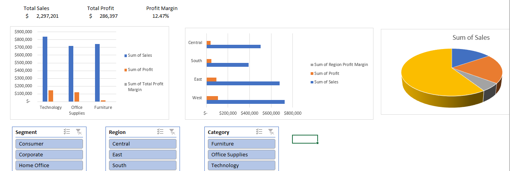
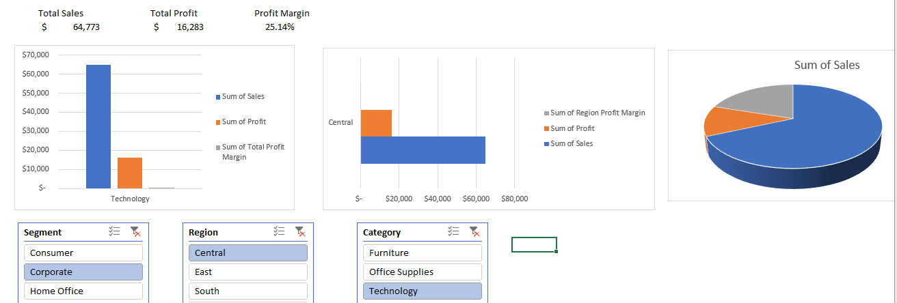

# 📊 Superstore Sales & Profitability Interactive Dashboard (Excel)

## 📌 Project Overview
This project focuses on analyzing retail sales data from the **Sample Superstore** dataset using **Microsoft Excel**. The primary goal is to evaluate profitability across categories, regions, and shipping modes to uncover actionable business insights and optimize profit margins.

---

## 📸 Interactive Dashboard Preview

---

## 🔑 Key Business Insights (EDA)
1. **Category Performance:**
   * **Technology** generates the highest profit margin (~17%) and sales.
   * **Furniture** faces severe profitability issues with an extremely low profit margin (~2%) despite high sales volume, driven by excessive discounting.

2. **Regional Performance:**
   * **West Region** is the top-performing market in both total sales and profit margin (~14.94%).
   * **Central Region** suffers from the lowest profit margin (~7.92%), indicating operational inefficiencies or aggressive pricing strategies.

3. **Logistics & Shipping:**
   * **Standard Class** handles over 50% of total sales volume while maintaining a stable ~12.08% profit margin.
   * **First Class** shipping achieves the highest profit margin (~13.93%), showing strong customer willingness to pay for premium delivery services.

---

## 🛠️ Tools & Excel Techniques Used
* **Power Query:** Data cleaning, custom column creation (`Delivery Days`, `Profit Margin`).
* **Pivot Tables & Calculated Fields:** Dynamic KPI aggregations and calculated custom fields (`Profit / Sales`) to prevent percentage summation errors.
* **Data Visualization:** Clustered Column, Bar, and Donut charts.
* **Interactive Features:** Slicers (`Segment`, `Region`, `Category`) cross-connected via **Report Connections** for seamless multi-dimensional filtering.

---

## 📁 Repository Structure
